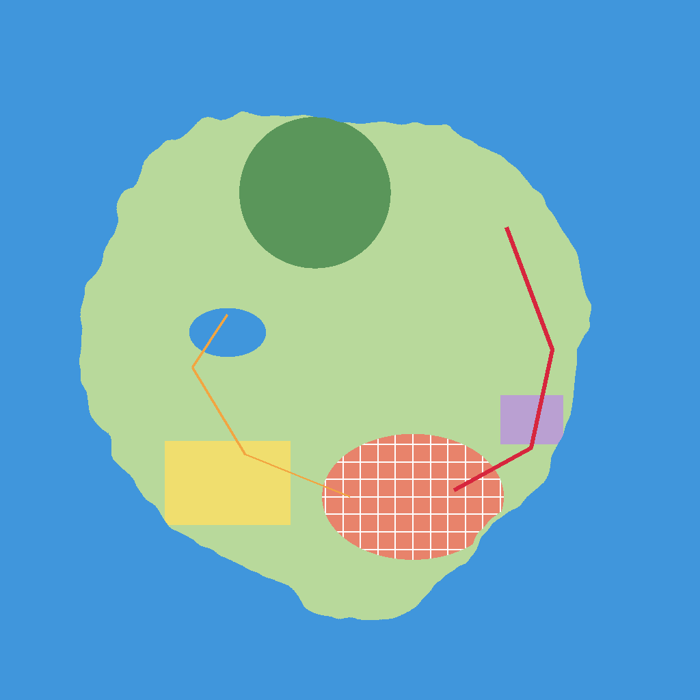
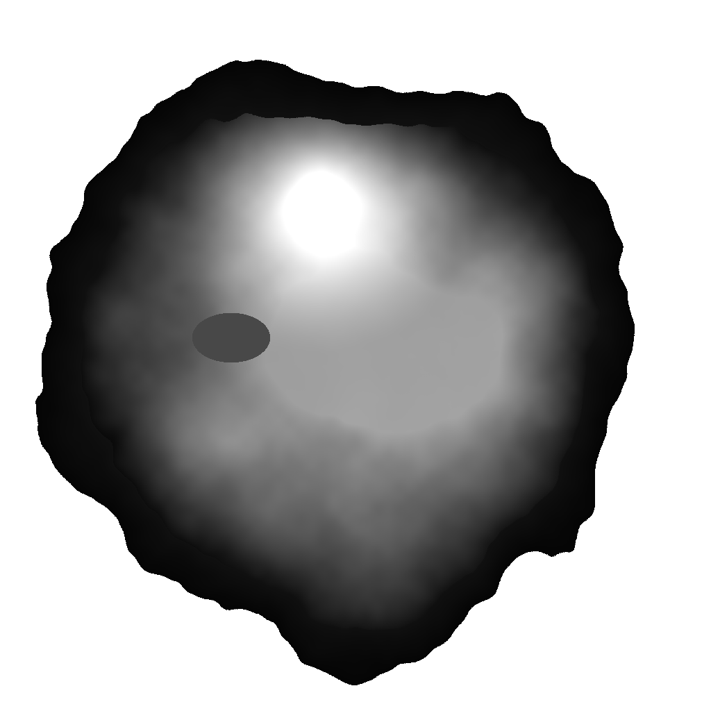

# Convention des cartes sources (modèles pour l'éditeur)

> Remplace, pour l'usage « décalquer une carte », l'ancienne `CONVENTION_CARTE_2D_VERS_MCFMAP.md` (obsolète). Une
> carte source n'est **jamais** une source de vérité (spec §8) : l'éditeur **propose**, l'auteur valide.

## En bref

Pour qu'une carte dessinée (ou générée par une IA) serve de modèle, fournir **deux images au même cadrage** :

| Image | Sert à | Forme |
| --- | --- | --- |
| **Carte couleurs** | relever l'eau, les zones (quartiers), les routes | aplats de couleurs de la palette ci-dessous, sans texte ni dégradé |
| **Carte de relief** | sculpter le terrain d'un coup | niveaux de gris : noir = point le plus bas, blanc = point le plus haut, transparent = pas de donnée |

« Même cadrage » = même zone du monde, même nord, mêmes bords : le pixel (x, y) des deux images est au même
endroit. Les tailles en pixels peuvent différer (l'éditeur recopie le calage en tenant compte de la largeur).

## Exemple complet

`docs/exemples/` (généré par `mcf/tools/exemple_carte/generer.py`, reproductible) : une île de 4 × 4 km,
1 024 pixels de côté (4 m par pixel), relief de −40 m (noir) à 600 m (blanc).

| Carte couleurs | Carte de relief |
| --- | --- |
|  |  |

Vérifié de bout en bout par `cargo test -p mcf_carte --test exemple_ile` (mesures brutes, `--release`, PC de dev) :
relief appliqué sur 9,1 millions de points en 0,87 s (sommet 600 m, lac à 140,7 m pour 140 attendus) ; mer relevée
et creusée en 0,89 s ; ville relevée d'un clic (0,61 km² pour ~0,62 attendus) ; autoroute relevée d'un clic sur
1 842 m.

## Carte couleurs

### Règles

1. **Aplats purs** : une couleur exacte par catégorie, pas de dégradé, pas d'ombrage, pas de texture, pas
   d'anticrénelage si possible (l'outil tolère un léger lissage : réglage « tolérance »).
2. **Pas de texte, de pictogramme, de légende ni de quadrillage** dans la zone de la carte. Une légende *à côté* est
   ignorée si elle sort de l'emprise de la carte ; dans la carte, elle serait relevée comme une tache.
3. **Routes en traits continus**, d'épaisseur constante, sans contour ni pointillés ; une couleur par classe.
4. **Nord en haut**, échelle connue (ou deux repères de distance connue, pour « 📏 Caler »).
5. Taille : 8 192 pixels de côté au plus, 64 Mpx au total pour tous les calques d'une carte.

### Palette

Les couleurs n'ont pas besoin d'être exactement celles-ci (on clique la couleur dans l'éditeur), mais elles doivent
être **nettement différentes entre catégories**. Celle-ci est sûre :

| Catégorie | Couleur | sRGB | Relevé comme |
| --- | --- | --- | --- |
| Eau (mer, lac, rivière large) | bleu | `64, 150, 220` | Eau / côte (creuse le relief) |
| Campagne (fond) | vert clair | `184, 217, 155` | — (rien) |
| Forêt | vert foncé | `90, 150, 90` | Taches (zone libre) |
| Secteur urbain | rouge saumon | `232, 131, 107` | Taches (quartier) |
| Industrie / logistique | mauve | `186, 160, 210` | Taches (quartier) |
| Agriculture | jaune | `240, 222, 110` | Taches |
| Autoroute | rouge vif | `215, 38, 61` | Routes → classe Autoroute |
| Route (interurbaine) | orange | `242, 165, 65` | Routes → classe Route |
| Rue | blanc | `255, 255, 255` | Routes → classe Rue |

Épaisseur conseillée des traits : au moins 2 pixels ; l'idéal est la largeur réelle (autoroute 30 m, route 10 m,
rue 14 m) à l'échelle de l'image.

## Carte de relief

1. **Niveaux de gris** : noir = altitude « noir », blanc = altitude « blanc », linéaire entre les deux. On choisit
   ces deux altitudes dans l'éditeur ; elles doivent tenir dans la **plage d'altitude de la carte** (réglée à la
   création, 4 096 m d'écart au plus).
2. **Transparent = pas de donnée** : le relief existant n'y est pas touché (utile pour ne fournir que le massif, ou
   laisser la mer au relevé de l'eau).
3. **8 bits** : 256 niveaux. Sur 640 m (exemple) un niveau vaut 2,5 m ; sur 2 500 m, ~10 m. Le **lissage** de
   l'éditeur adoucit ces marches (8 à 30 m conseillés) ; il ne recrée pas le détail absent de l'image. Le 16 bits
   n'est pas encore lu (les calques sont convertis en 8 bits) : à prévoir si le besoin se confirme.
4. Les **plans d'eau** gagnent à être **plats** dans la carte de relief (même gris sur tout le lac).

## Dans l'éditeur, pas à pas

1. **Cadre → Nouvelle carte** : côté (ex. 4,096 km), **altitudes** (ex. −40 à 600 m), « Créer ».
2. **Importer une image…** : la carte couleurs. Elle couvre la largeur de la carte ; si l'emprise n'est pas la même,
   « 📏 Caler » (deux repères, distance réelle) puis « ✋ Déplacer ».
3. **Importer une image…** : la carte de relief, puis **« Même calage que… » → la carte couleurs**.
4. Sur le calque de relief : altitudes du **noir** et du **blanc**, **lissage**, « ⛰ Appliquer comme relief ».
5. Sur le calque couleurs, **relevé assisté** : « Eau / côte » (clic dans la mer), « Taches » (clic dans une ville),
   « Routes » (clic sur un trait, classe choisie avant). Valider / rejeter chaque proposition.
6. Tout s'annule (Ctrl+Z), étape par étape.

## Et nos cartes actuelles (`map_1.png`, `map_sat.png`) ?

- `map_1.png` (plan directeur) **ne suit pas cette convention** : textes, pictogrammes, quadrillage, dégradés et
  courbes de niveau dans la carte. Le relevé marche quand même pour la mer, le Grand Lac et des morceaux de l'A1
  (essai du 2026-11-23, voir `todo.md`), mais les villes sont morcelées et les routes coupées aux étiquettes.
- `map_sat.png` (vue satellite) n'a pas d'aplats : bonne comme **calque visuel** pour décalquer à la main, pas pour
  le relevé automatique. Ses ombres **ne donnent pas** d'altitudes.
- **Aucune des deux ne contient le relief en chiffres** : il faut une carte de relief en niveaux de gris.

Pour les obtenir par génération d'images, demander, **à partir de `map_1.png`** :

> « Même cadrage exact que l'image fournie (mêmes bords, même nord, même taille en pixels). Version *carte couleurs* :
> aplats unis sans aucun texte, pictogramme, légende, quadrillage, ombrage ni dégradé. Mer et lacs en bleu
> (64, 150, 220), campagne en vert clair (184, 217, 155), forêts en vert foncé (90, 150, 90), villes en rouge saumon
> (232, 131, 107), industrie en mauve (186, 160, 210), agriculture en jaune (240, 222, 110). Autoroute A1 en trait
> rouge vif continu (215, 38, 61), routes principales en orange (242, 165, 65), rues en blanc, traits d'épaisseur
> constante, sans contour. »

> « Même cadrage exact que l'image fournie. Version *carte de relief* en niveaux de gris : noir = niveau de la mer,
> blanc = plus haut sommet (2 412 m), dégradés continus sans aucun texte, trait, ombrage ni relief ombré. Mer en noir
> uniforme, lacs en gris uniforme à leur altitude (Grand Lac : 310 m). »

Une image générée ne sera pas parfaitement superposable : vérifier dans l'éditeur (opacité des calques) et recaler
si besoin. Pour `map_1.png` (32 km), créer une carte de 32,768 km avec une plage d'altitudes de −100 à 2 500 m.
